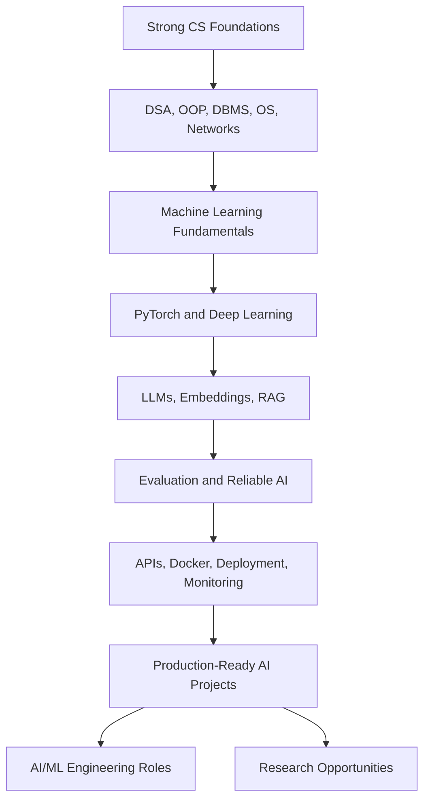

  

  

  

---

## 👋 About Me

Hello! I'm **Deeptesh Rout**, a Computer Science and Engineering undergraduate at **ITER, Siksha 'O' Anusandhan (SOA) University**, graduating in 2027.

I'm interested in **AI/ML engineering, machine learning research, backend development, and full-stack applications**. I enjoy turning concepts into working projects, understanding the mathematics behind algorithms, and improving systems through experimentation.

- 🎓 **Education:** B.Tech in Computer Science and Engineering, ITER / SOA University
- 📊 **Current CGPA:** 9.23/10
- 💻 **Programming:** Python, Java, SQL
- 🧠 **Interests:** Machine Learning, Deep Learning, NLP, LLM applications, RAG, and backend engineering
- 🧩 **Problem solving:** 450+ LeetCode problems (approximate; update as your profile changes)
- 🎯 **Long-term direction:** Become a strong AI/ML engineer and build reliable, useful AI systems
- 🌱 **Currently improving:** PyTorch, model evaluation, retrieval-augmented generation, APIs, and production engineering

> I aim to build a portfolio that demonstrates real implementation, careful evaluation, clear documentation, and honest reporting—not just a list of technologies.

## 🔗 Find Me Online

| Platform | Link |
|:--|:--|
| 🧑‍💻 GitHub | [github.com/deeptesh-rout](https://github.com/deeptesh-rout) |
| 💼 LinkedIn | [Deeptesh Rout](https://www.linkedin.com/in/deeptesh-rout-2b418b2b4/) |
| 🧩 LeetCode | [LeetCode profile](https://leetcode.com/) |
| 🏆 AtCoder | [DeepteshRout2004](https://atcoder.jp/) |
| 💻 Codeforces | [deepteshrout2294](https://codeforces.com/) |

## 📑 Contents

- [Skills](#-skills-and-tools)
- [Projects](#-selected-projects)
- [Certifications and Learning](#-certifications-and-learning)
- [Career Roadmap](#-career-roadmap)
- [Research Interests](#-research-interests)
- [Current Priorities](#-current-priorities)
- [GitHub Activity](#-github-activity)
- [Connect](#-connect-and-collaborate)

---

## 🧰 Skills and Tools

### Languages

### AI / Machine Learning

### Tools and Platforms

**Skill-level note:** This list includes tools I have used in coursework or projects and technologies I am actively learning. It does not imply expert-level proficiency in every item.

---

## 🚀 Selected Projects

These are based on projects I've worked on. Add the corresponding repository links and update each status before publishing.

### 1. Skill Gap AI — Resume and Job Description Analysis
**Focus:** NLP, semantic similarity, skill extraction, Streamlit

- Extracts skills from resumes and job descriptions and compares the two.
- Uses embeddings/similarity to identify overlap and potential skill gaps.
- Uses O*NET skills data as a reference source and explores an LLM-assisted explanation workflow.
- **Next improvements:** add evaluation examples, improve extraction quality, and report measurable results.

### 2. Vectorless RAG / Codebase Analysis
**Focus:** Retrieval-augmented generation, code understanding, LLM applications

- Explores ways to answer questions about a codebase using structured context and retrieval-oriented techniques.
- Emphasizes useful answers grounded in the source code rather than unsupported guesses.
- **Next improvements:** create a reproducible benchmark, test on multiple repositories, and measure answer correctness.

### 3. PageIndex-Style Document Retrieval
**Focus:** Information retrieval, MiniLM, FAISS, BM25

- Experiments with combining semantic retrieval and lexical search for document discovery.
- Investigates how hybrid retrieval can improve access to relevant context.
- **Next improvements:** evaluate Recall@k, MRR, and answer grounding on a labelled query set.

### 4. Customer Churn Prediction
**Focus:** Scikit-learn, classification, model evaluation

- Built an ensemble using soft voting with Logistic Regression, Random Forest, and XGBoost.
- Reported project metrics: **75.07% accuracy, 0.7952 ROC-AUC, and 0.5965 F1-score**.
- The F1 score highlights why accuracy alone is not enough to judge a classifier.
- **Next improvements:** examine class imbalance, tune decision thresholds, and compare against simple baselines.

### 5. Handwritten Image Recognition
**Focus:** CNNs, PyTorch, OpenCV

- Built a convolutional neural network workflow for handwritten image recognition.
- Used image preprocessing to prepare inputs for the model.
- **Next improvements:** document the dataset split, add a confusion matrix, and compare model variants.

### 6. GennetiX — AI-Assisted Fitness Planning
**Focus:** Generative AI, API integration, application development

- Explored a fitness-plan generation application using Vapi and Gemini.
- Focused on connecting a user-facing interface with an AI-generated plan.
- **Next improvements:** add clear safety boundaries, input validation, and reliable error handling.

### 7. Full-Stack LLM Applications
**Focus:** APIs, frontend/backend integration, LLM workflows

- Builds practical experiments that connect application interfaces with language-model capabilities.
- Interested in making AI tools easier to use, test, and maintain.

### 8. Titanic Classification
**Focus:** Data preprocessing, feature engineering, Random Forest

- Practised an end-to-end tabular machine-learning workflow.
- Previously recorded a public score of approximately **0.78229**; verify the competition page before treating this as a current achievement.

> **Important:** Add repository links only after checking that the repositories are public and the READMEs accurately describe your contribution. Metrics above are project-reported results, not guarantees of general performance.

---

## 🏅 Certifications and Learning

Learning and certificates I have recorded:

- **Claude and Amazon Bedrock** — Anthropic Academy
- **Google 5-Day AI Agents Intensive**
- **Model Context Protocol (MCP)** learning/certificate
- **CNN Visualization** learning/certificate
- **Infosys Networking** and **Generative AI** certificates

Other technical learning includes Python, NumPy, Matplotlib, SQL, data structures and algorithms, machine learning, and deep learning.

> Add certificate URLs and issue dates when available. Only label a course as completed if you have completed it and can verify the certificate.

---

## 🎯 Career Roadmap

My goal is to grow into an **AI/ML engineer who can build, evaluate, and deploy reliable systems**. Research remains a possible long-term direction as I gain experience and identify meaningful problems.

### Current learning sequence

| Stage | Focus | Practical outcome |
|:--:|:--|:--|
| 1 | Python, Java, DSA, SQL, OOP | Clear fundamentals and consistent problem-solving |
| 2 | NumPy, pandas, Matplotlib, statistics | Reproducible data analysis |
| 3 | Classical ML and evaluation | Baselines, validation, metrics, error analysis |
| 4 | PyTorch and deep learning | Train and evaluate neural networks |
| 5 | NLP, transformers, embeddings, RAG | Evidence-grounded LLM applications |
| 6 | FastAPI, Docker, testing, deployment | Maintainable AI services |
| 7 | Research reading and replication | Reproducible experiments and technical reports |

### Career priorities

1. **Strong fundamentals:** algorithms, mathematics, software engineering, and databases.
2. **Evidence of skill:** complete projects with tests, documentation, and measurable evaluation.
3. **Internships and collaboration:** seek relevant opportunities and learn from code review.
4. **AI/ML depth:** develop practical competence with PyTorch, LLMs, RAG, and model evaluation.
5. **Long-term growth:** consider research or postgraduate study when it supports a clear career goal.

---

## 🔬 Research Interests

Areas I am interested in exploring as my experience grows:

- Trustworthy and evidence-grounded AI
- Retrieval-augmented generation (RAG) and information retrieval
- Large language model evaluation and hallucination reduction
- Natural language processing and multilingual systems
- Applied machine learning and model interpretability
- Efficient deployment of useful AI applications

These are **interests**, not claims of published research. Any future research project should have a specific question, baseline, evaluation protocol, limitations, and reproducible results.

---

## 📌 Current Priorities

- [ ] Strengthen Python and Java fundamentals.
- [ ] Keep practising DSA consistently.
- [ ] Improve statistics, linear algebra, and the mathematics behind ML.
- [ ] Build stronger PyTorch projects with documented evaluation.
- [ ] Improve existing projects instead of leaving many unfinished repositories.
- [ ] Learn API design, testing, Docker, and deployment.
- [ ] Prepare for AI/ML and software engineering internships.
- [ ] Keep my resume, GitHub repositories, and certificate links accurate and up to date.

---

## 📈 GitHub Activity

---

## 📜 My Working Principles

1. **Understand the fundamentals.** Do not rely on copying code without understanding it.
2. **Finish what I start.** A complete, tested project is more useful than several unfinished ones.
3. **Measure performance honestly.** Report baselines, evaluation data, and limitations.
4. **Build responsibly.** Respect licences, privacy, and data permissions.
5. **Document clearly.** Every serious repository should explain setup, usage, tests, and known limitations.
6. **Keep claims verifiable.** Goals are not achievements, and a model score is meaningful only with context.
7. **Learn continuously.** Use mistakes, code reviews, and experiments to improve.

---

## 🤝 Connect and Collaborate

I'm happy to connect with students, developers, and researchers interested in **AI/ML, NLP, LLM applications, RAG, and software engineering**. I value thoughtful feedback, open-source collaboration, and opportunities to build systems that solve real problems.

- 💼 [LinkedIn](https://www.linkedin.com/in/deeptesh-rout-2b418b2b4/)
- 💻 [GitHub](https://github.com/deeptesh-rout)

If you find one of my projects useful, feel free to open an issue, suggest an improvement, or contribute through a pull request.

---

**Build deliberately. Evaluate honestly. Improve continuously.**

